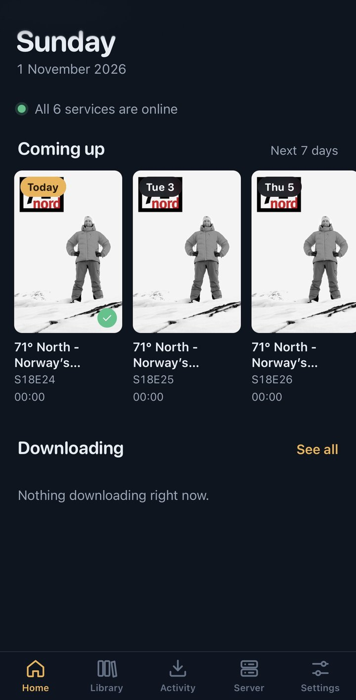
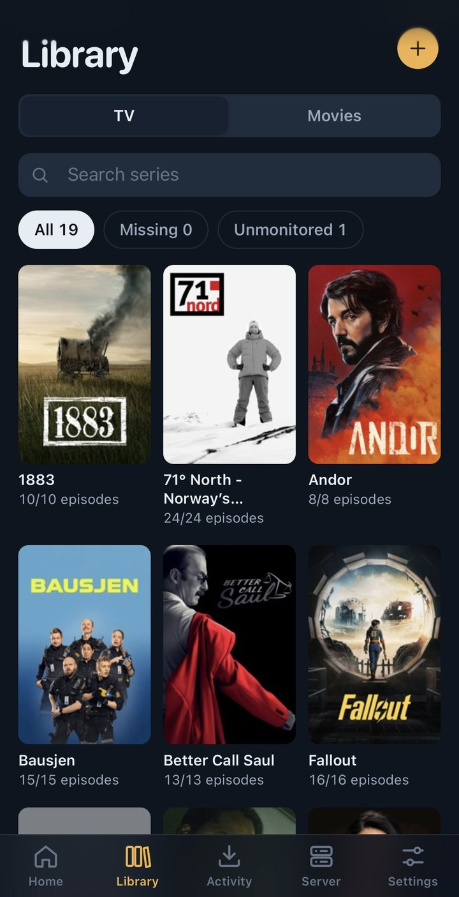
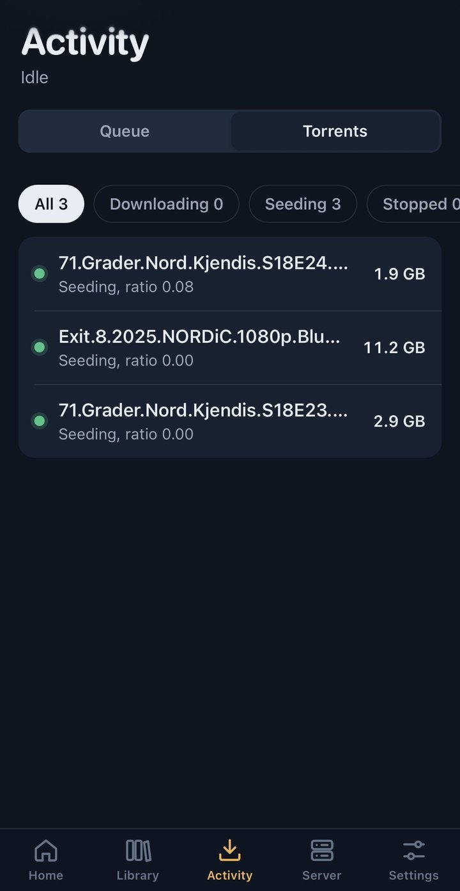
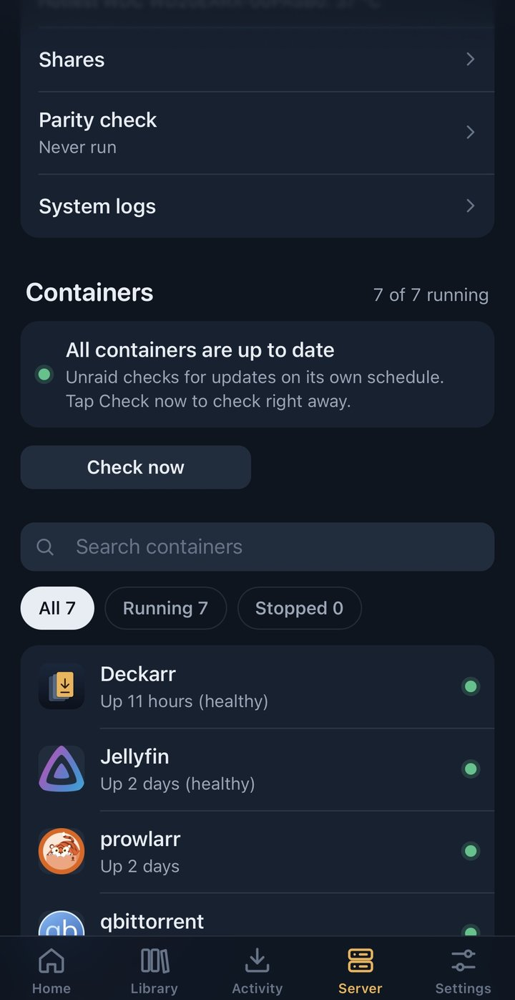
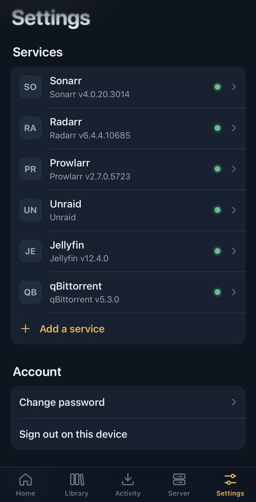

# Deckarr

A free, self-hosted web app for your media server, made for phones and tablets: iPhone and iPad, Android (including GrapheneOS), and any modern browser. It runs as one small container on Unraid and you add it to your home screen like a normal app.

<p>
  
  
  
  
  
</p>

| Tab | What you can do |
| --- | --- |
| Home | Service status, the next 7 days of episodes, movies and albums, active downloads, and what's playing on Jellyfin |
| Library | Browse Sonarr, Radarr and Lidarr. Search for releases, monitor titles or seasons, remove titles, add new series, movies and artists |
| Activity | The *arr queue, qBittorrent (pause, resume, delete) and SABnzbd |
| Server | Unraid array, CPU, RAM, CPU temperature and power, network traffic, UPS. Disks with temperatures and errors, shares, parity checks (start, pause, cancel, history), Unraid notifications (archive, delete), system logs. Containers: start, stop, restart, pause, update (one or all), details, ports and logs, filters and batch actions. VMs: start, shut down, pause, resume, restart, force stop. **Proxmox VE:** nodes with CPU, memory, load and uptime; VMs and LXC containers (start, shut down, restart, pause, stop, reset); storage, disk health, package updates, tasks and system log. Jellyfin library scan, Prowlarr indexer status, health warnings |
| Settings | Add services, test connections, change the password |

Supported services: Sonarr, Radarr, Lidarr, Prowlarr, Bazarr, qBittorrent, SABnzbd, Jellyfin, Unraid 7.2+ and Proxmox VE 7+.

API keys are stored only on the server (`/config/config.json`, mode 600). Your phone never sees them; it talks to Deckarr, and Deckarr talks to your services.

---

## Install on Unraid

### From the Apps tab (one click)

1. Open **Apps** in Unraid and search for **Deckarr**.
2. Click **Install**, then **Apply**. The defaults work for most servers.
3. Continue with [First run on your phone](#first-run-on-your-phone).

### Before Deckarr is listed in Apps

Run this once in the Unraid terminal (the `>_` icon top right):

```bash
wget -O /boot/config/plugins/dockerMan/templates-user/my-Deckarr.xml \
  https://raw.githubusercontent.com/bjaane/deckarr/main/templates/deckarr.xml
```

Then go to **Docker > Add Container**, choose **Deckarr** under *Template*, and click **Apply**.

### Docker CLI or Compose

```bash
docker run -d --name deckarr --restart unless-stopped \
  -p 8484:8484 \
  -v /mnt/user/appdata/deckarr:/config \
  ghcr.io/bjaane/deckarr:latest
```

The container fixes the permissions of `/config` itself and then runs as `PUID`/`PGID` (default `99`/`100`, Unraid's `nobody:users`).

## Install on Proxmox VE

Run this in the Proxmox shell (node > **Shell**, or SSH as root):

```bash
bash -c "$(curl -fsSL https://raw.githubusercontent.com/bjaane/deckarr/main/scripts/proxmox-install.sh)"
```

It creates a small Debian LXC container (1 CPU, 512 MB memory, 4 GB disk, DHCP on `vmbr0`) and installs Deckarr in it, without Docker. It shows the settings and asks before it creates anything, then prints the address to open. The container starts with the host.

To change the defaults, put settings in front of the command, for example `CTID=150 STORAGE=local-zfs IP=192.168.1.50/24 GATEWAY=192.168.1.1`. The full list is at the top of [the script](scripts/proxmox-install.sh).

Update Deckarr later with:

```bash
pct exec <container-id> -- deckarr-update
```

Settings are kept in `/var/lib/deckarr` inside the container. Deckarr also runs fine with Docker on Proxmox, in a VM or LXC that already has Docker; use the Docker command above.

### First run on your phone

1. Open your browser and go to `http://<your-unraid-ip>:8484`.
2. Create a password. You type it once per device.
3. Go to **Settings > Add a service** and add your apps. Use **Test connection** before saving.
4. Add Deckarr to your home screen so it opens full screen from its own icon:

| Device | How |
| --- | --- |
| iPhone and iPad (Safari) | Tap **Share**, then **Add to Home Screen** |
| Android: Chrome, Vanadium (GrapheneOS), Samsung Internet, Edge, Brave | Tap **Install Deckarr** in Deckarr's Settings when it appears, or open the browser menu (⋮) and tap **Install app** or **Add to Home screen** |
| Android: Firefox | Open the menu (⋮) and tap **Add to Home screen** |
| Computer (Chrome, Edge) | Click the install icon in the address bar, or use **Install Deckarr** in Settings |

On Android, a full-screen app needs `https://`. Over plain `http://` the icon is a shortcut that opens in the browser. Everything still works, it just shows the browser bar. See [Access away from home](#access-away-from-home) for easy ways to get HTTPS.

The Android back button closes open panels before it leaves a page.

> **Use your Unraid LAN IP for service addresses**, for example `http://192.168.1.10:8989`. `localhost` inside the Deckarr container points at Deckarr itself.

---

## Where to find the keys

| Service | Where |
| --- | --- |
| Sonarr, Radarr, Lidarr, Prowlarr | Settings > General > Security > API Key |
| Bazarr | Settings > General > Security > API Key |
| SABnzbd | Config > General > Security > API Key (not the NZB key) |
| qBittorrent | qBittorrent 5.2+: an API key from Tools > Options > Web UI. Older versions: Web UI username and password, or leave both blank if qBittorrent skips login for your subnet |
| Jellyfin | Dashboard > API Keys > New API key |
| Proxmox VE | Datacenter > Permissions > API Tokens > Add. Paste the whole token as `user@realm!tokenid=secret`, at the address `https://<host>:8006` with **Allow self-signed certificate** on. Give the token the **PVEAuditor** role on `/` to see everything and **PVEVMUser** to start and stop guests. Package updates also need **Sys.Modify** (for example **PVESysAdmin**). If **Privilege Separation** is on, the roles must be given to the token itself, not only to the user |
| Unraid 7.2+ | Settings > Management Access > API Keys. Use the Admin role, or read access to everything plus update access to Docker, VMs, Array and Notifications (needed for container, VM, parity and notification actions) |

---

## Access away from home

Don't forward port 8484 to the internet. Use one of these instead:

- **Tailscale (recommended, free):** install Tailscale on Unraid (built in from Unraid 7) and on your phone, then open `http://<unraid-tailscale-ip>:8484`. With **Tailscale Serve** you also get an `https://` address, which lets Android install Deckarr as a full-screen app.
- **Reverse proxy with HTTPS** (Nginx Proxy Manager, SWAG, Caddy): point it at port 8484. Sub-paths such as `https://example.com/deckarr/` work. Pass `X-Forwarded-Proto` so the session cookie is marked secure.

Add the home screen icon from the address you'll use most, because the icon remembers that address.

---

## Push notifications for server alerts

Deckarr can send alerts from Unraid and Proxmox VE to your phone, even when Deckarr is closed. Turn it on per device in **Settings > Notifications** and choose **Alerts**, **Warnings** (alerts and warnings) or **Everything**. **Send a test notification** checks the whole path.

The Deckarr server checks your servers every minute and sends what's new straight to your device's push service (Apple, Google or Mozilla), encrypted for that device. No account, app store or relay server is involved. With several servers, each notification starts with the server's name.

| Server | You get | Tapping it opens |
| --- | --- | --- |
| Unraid | Unraid's own notifications (disk temperatures, parity checks, array errors, and so on) at their own level | Unraid's notification list |
| Proxmox VE | **Alert:** a failed task (backup, VM or container start, migration), a node going offline, a disk failing its SMART check. **Warning:** a task finished with warnings, storage over 90% full. **Everything:** also a node coming back online | The task list, storage or disks |

Nothing needs to be set up in Proxmox: Deckarr reads it with the same API token. Disk health is checked every 15 minutes, because reading SMART data is slower.

What you need:

- **HTTPS.** Browsers only allow notifications on `https://` addresses. Open Deckarr through Tailscale Serve or a reverse proxy (see above) and turn notifications on from that address.
- **iPhone and iPad:** iOS 16.4 or newer, with Deckarr added to the Home Screen and opened from its icon.
- **Android:** Chrome, Vanadium, Samsung Internet and Edge deliver notifications through Google Play services. On **GrapheneOS**, install sandboxed Google Play, or use **Firefox**, which has its own push service.
- **The Unraid API key** needs read access to notifications. The Admin role or the permissions listed above already include it. **The Proxmox token** needs the PVEAuditor role, which also covers tasks, storage and disks.
- **The Deckarr container** needs internet access to reach the push services.

Which events Unraid reports, such as disk temperatures, parity check results or array errors, is set in Unraid under **Settings > Notification Settings**.

### Backup address for a service

If Deckarr itself runs somewhere that isn't always on the same network as a service (for example on another machine, or a service on a second server), add a **Backup address** under *Optional* when you edit the service, such as a Tailscale name or IP (`http://tower.tailnet.ts.net:8989`). Deckarr tries the main address first and switches to the backup when the main one can't be reached. After a switch it keeps using the backup for 5 minutes before trying the main address again. The same API key or login is used for both.

---

## Settings

| Variable | Default | Purpose |
| --- | --- | --- |
| `PORT` | `8484` | Port inside the container |
| `CONFIG_DIR` | `/config` | Where `config.json` and `auth.json` are stored |
| `APP_PASSWORD` | not set | Optional fixed password. If set, the in-app password setup and change are disabled |
| `PUID` / `PGID` | `99` / `100` | User and group the app runs as |

Forgot the password? Stop the container, delete `auth.json` in the appdata folder (`/mnt/user/appdata/deckarr`), and start it again. You'll be asked to create a new one. Your services are kept.

---

## Update

Unraid shows **Update ready** on the Docker tab when a new version is published. Click it. Your settings are kept.

### Publishing a release

Bump `version` in `package.json`, add a section for that version to `CHANGELOG.md`, run `node scripts/sync-template.mjs` to copy it into the Unraid template, and merge into `main`. The Release workflow then creates the `vX.Y.Z` tag and the GitHub release, and builds `:latest` and `:X.Y.Z`.

### Run the test version

Every push to the `test` branch publishes `ghcr.io/bjaane/deckarr:test`. To use it, open **Docker**, click the Deckarr icon > **Edit**, set **Repository** to `ghcr.io/bjaane/deckarr:test`, and click **Apply**. Unraid then shows **Update ready** whenever a new test build is published. Set it back to `ghcr.io/bjaane/deckarr:latest` to return to releases.

## Back up

Back up `/mnt/user/appdata/deckarr`. It contains your API keys and the key that signs push notifications (`push.json`), so treat it like a password file. If `push.json` is lost, turn notifications off and on again on each device.

---

## Tip: let Jellyfin pick up new files immediately

In **Sonarr and Radarr**, go to **Settings > Connect > + > Emby / Jellyfin**:

1. Turn on *On Import* and *On Upgrade*.
2. Turn on **Update Library**.
3. Enter the Jellyfin address and an API key.

If Sonarr and Jellyfin see the media at different paths (`/tv` vs `/data/tv`), fill in the path mapping.

---

## Troubleshooting

| Message | Fix |
| --- | --- |
| *Nothing is answering at …* | Wrong IP or port, or the app is stopped. Use the Unraid LAN IP, not `localhost` |
| *… rejected the API key* | Copy the key again. For SABnzbd, use the API key, not the NZB key |
| *… redirected to …* | The app forces HTTPS or a different path. Use the address it redirects to |
| *… uses a certificate Deckarr doesn't trust* | Turn on **Allow self-signed certificate** for that service |
| *Unraid: Cannot query field …* | Update Unraid. The API needs Unraid 7.2 or newer |
| *qBittorrent has temporarily blocked this server* | Too many failed logins. Wait, then fix the username and password |
| *Notifications need Deckarr to be opened over https://* | Open Deckarr through Tailscale Serve or a reverse proxy with HTTPS. See [Push notifications](#push-notifications-for-server-alerts) |
| *The browser couldn't set up notifications* (Android) | Chromium browsers need Google Play services for notifications. On GrapheneOS, install sandboxed Google Play, or use Firefox |

The container log in the Docker tab shows server-side errors.

---

## For tinkerers

```
server/         Node.js server, no dependencies
  index.js      routes, sign-in, static files
  upstream.js   talks to each service, injects credentials
  push.js       Unraid push notifications (Web Push, no dependencies)
  types.js      list of supported services
public/         the app (plain JavaScript, no build step)
  js/services.js  one adapter per service
  js/views/       Home, Library, Activity, Server, Settings
```

To add another Sonarr-style app, add an entry to `SERVICE_TYPES` in `server/types.js` and to `ARR` and `API_VERSION` in `public/js/services.js`.

Build the image yourself:

```bash
docker build -t deckarr .
```

Run locally without Docker (Node 20+):

```bash
npm run dev    # stores settings in ./config, serves on http://localhost:8484
```
