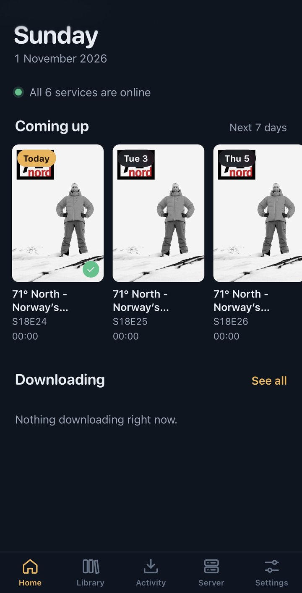
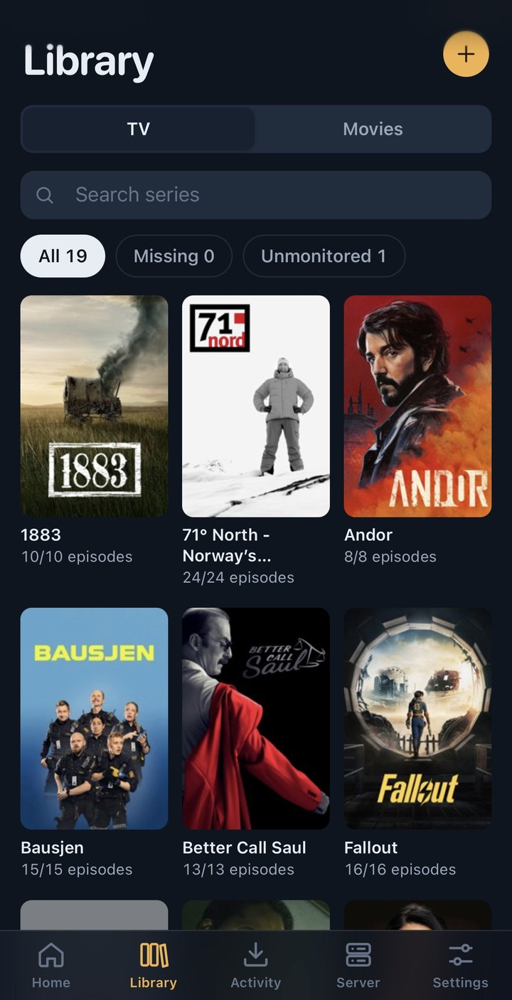
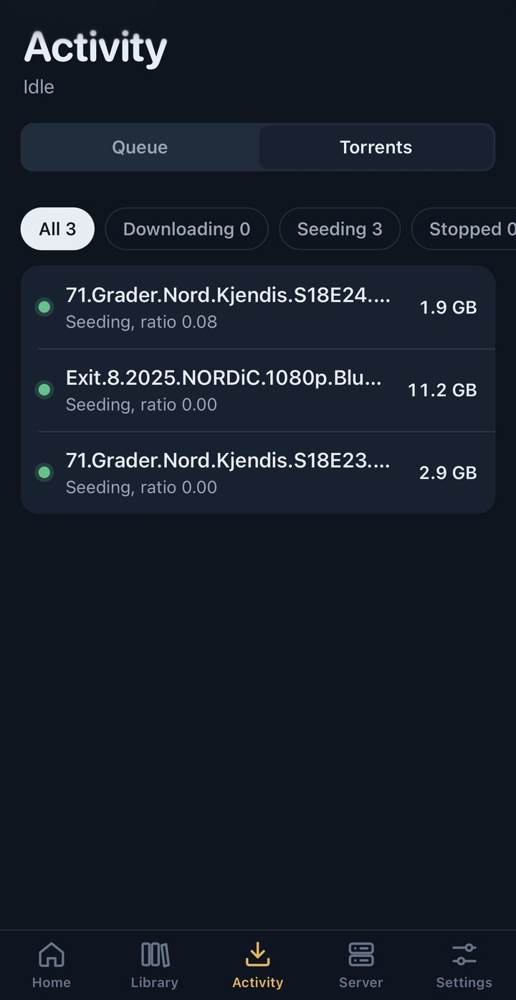
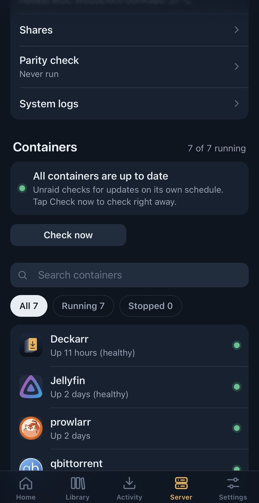
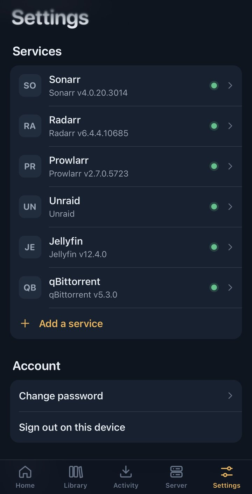

# Deckarr

A free, self-hosted dashboard for your media server. Sonarr, Radarr, Lidarr, Prowlarr, Bazarr, qBittorrent, SABnzbd, Jellyfin and your server in one place, in any browser.

<p>
  
  
  
  
  
</p>

## Install

```bash
docker run -d --name deckarr --restart unless-stopped \
  -p 8484:8484 \
  -v /path/to/deckarr:/config \
  ghcr.io/bjaane/deckarr:latest
```

Open `http://<server-ip>:8484`, create a password, and add your services under **Settings**.

## Update

```bash
docker pull ghcr.io/bjaane/deckarr:latest
docker rm -f deckarr
```

Then run the install command again. Your settings are kept in `/config`.

## License

MIT
