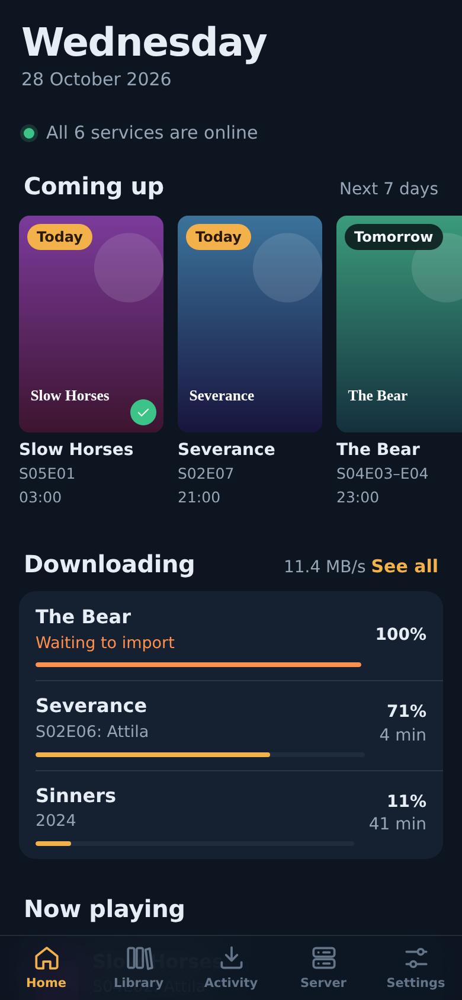
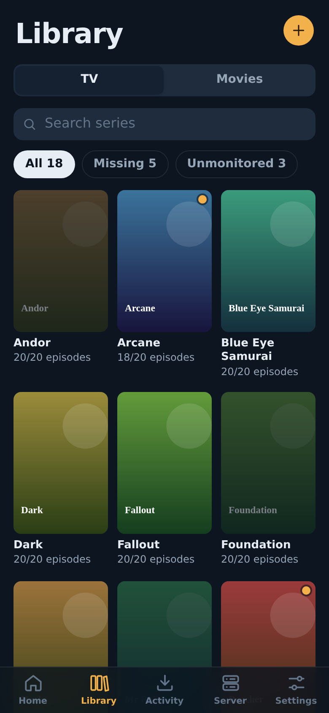
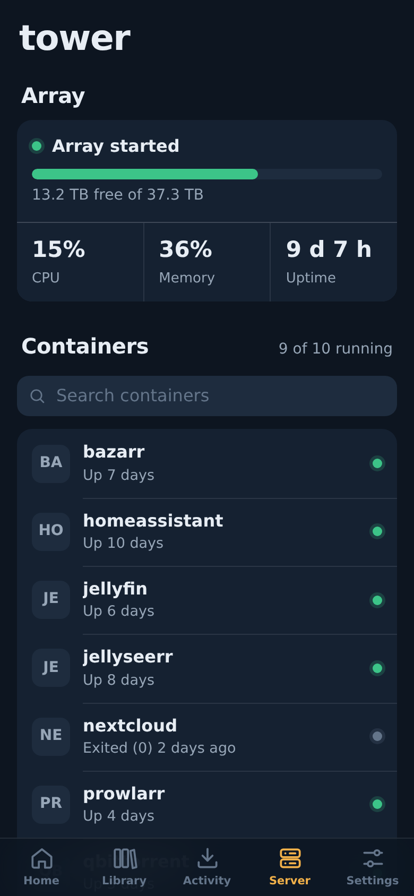

# Deckarr

A free, self-hosted iPhone web app for your media server. It runs as one small container on Unraid and you add it to your Home Screen like a normal app.

<p>
  
  
  
</p>

| Tab | What you can do |
| --- | --- |
| Home | Service status, the next 7 days of episodes, movies and albums, active downloads, and what's playing on Jellyfin |
| Library | Browse Sonarr, Radarr and Lidarr. Search for releases, monitor titles or seasons, remove titles, add new series, movies and artists |
| Activity | The *arr queue, qBittorrent (pause, resume, delete) and SABnzbd |
| Server | Unraid array, CPU and RAM, start, stop and restart containers and VMs, Jellyfin library scan, Prowlarr indexer status, health warnings |
| Settings | Add services, test connections, change the password |

Supported services: Sonarr, Radarr, Lidarr, Prowlarr, Bazarr, qBittorrent, SABnzbd, Jellyfin and Unraid 7.2+.

API keys are stored only on the server (`/config/config.json`, mode 600). The phone never sees them; it talks to Deckarr, and Deckarr talks to your services.

---

## Install on Unraid

### From the Apps tab (one click)

1. Open **Apps** in Unraid and search for **Deckarr**.
2. Click **Install**, then **Apply**. The defaults work for most servers.
3. Continue with [First run on the iPhone](#first-run-on-the-iphone).

### Before Deckarr is listed in Apps

Run this once in the Unraid terminal (the `>_` icon top right):

```bash
wget -O /boot/config/plugins/dockerMan/templates-user/my-Deckarr.xml \
  https://raw.githubusercontent.com/bjaane/deckarr/main/templates/deckarr.xml
```

Then go to **Docker > Add Container**, choose **Deckarr** under *Template*, and click **Apply**.

### Docker CLI or Compose

```bash
docker run -d --name deckarr --restart unless-stopped \
  -p 8484:8484 \
  -v /mnt/user/appdata/deckarr:/config \
  ghcr.io/bjaane/deckarr:latest
```

The container fixes the permissions of `/config` itself and then runs as `PUID`/`PGID` (default `99`/`100`, Unraid's `nobody:users`).

### First run on the iPhone

1. Open Safari and go to `http://<your-unraid-ip>:8484`.
2. Create a password. You type it once per device.
3. Go to **Settings > Add a service** and add your apps. Use **Test connection** before saving.
4. Tap **Share > Add to Home Screen**. Deckarr now opens full screen from its own icon.

> **Use your Unraid LAN IP for service addresses**, for example `http://192.168.1.10:8989`. `localhost` inside the Deckarr container points at Deckarr itself.

---

## Where to find the keys

| Service | Where |
| --- | --- |
| Sonarr, Radarr, Lidarr, Prowlarr | Settings > General > Security > API Key |
| Bazarr | Settings > General > Security > API Key |
| SABnzbd | Config > General > Security > API Key (not the NZB key) |
| qBittorrent | Web UI username and password. Leave both blank if qBittorrent skips login for your subnet |
| Jellyfin | Dashboard > API Keys > New API key |
| Unraid 7.2+ | Settings > Management Access > API Keys. Use the Admin role, or read and update access to Docker, VMs and Array |

---

## Access away from home

Don't forward port 8484 to the internet. Use one of these instead:

- **Tailscale (recommended, free):** install Tailscale on Unraid (built in from Unraid 7) and on the iPhone, then open `http://<unraid-tailscale-ip>:8484`.
- **Reverse proxy with HTTPS** (Nginx Proxy Manager, SWAG, Caddy): point it at port 8484. Sub-paths such as `https://example.com/deckarr/` work. Pass `X-Forwarded-Proto` so the session cookie is marked secure.

Add the Home Screen icon from the address you'll use most, because the icon remembers that address.

### Backup address for a service

If Deckarr itself runs somewhere that isn't always on the same network as a service (for example on another machine, or a service on a second server), add a **Backup address** under *Optional* when you edit the service, such as a Tailscale name or IP (`http://tower.tailnet.ts.net:8989`). Deckarr tries the main address first and switches to the backup when the main one can't be reached. After a switch it keeps using the backup for 5 minutes before trying the main address again. The same API key or login is used for both.

---

## Settings

| Variable | Default | Purpose |
| --- | --- | --- |
| `PORT` | `8484` | Port inside the container |
| `CONFIG_DIR` | `/config` | Where `config.json` and `auth.json` are stored |
| `APP_PASSWORD` | not set | Optional fixed password. If set, the in-app password setup and change are disabled |
| `PUID` / `PGID` | `99` / `100` | User and group the app runs as |

Forgot the password? Stop the container, delete `auth.json` in the appdata folder (`/mnt/user/appdata/deckarr`), and start it again. You'll be asked to create a new one. Your services are kept.

---

## Update

Unraid shows **Update ready** on the Docker tab when a new version is published. Click it. Your settings are kept.

## Back up

Back up `/mnt/user/appdata/deckarr`. It contains your API keys, so treat it like a password file.

---

## Tip: let Jellyfin pick up new files immediately

In **Sonarr and Radarr**, go to **Settings > Connect > + > Emby / Jellyfin**:

1. Turn on *On Import* and *On Upgrade*.
2. Turn on **Update Library**.
3. Enter the Jellyfin address and an API key.

If Sonarr and Jellyfin see the media at different paths (`/tv` vs `/data/tv`), fill in the path mapping.

---

## Troubleshooting

| Message | Fix |
| --- | --- |
| *Nothing is answering at …* | Wrong IP or port, or the app is stopped. Use the Unraid LAN IP, not `localhost` |
| *… rejected the API key* | Copy the key again. For SABnzbd, use the API key, not the NZB key |
| *… redirected to …* | The app forces HTTPS or a different path. Use the address it redirects to |
| *… uses a certificate Deckarr doesn't trust* | Turn on **Allow self-signed certificate** for that service |
| *Unraid: Cannot query field …* | Update Unraid. The API needs Unraid 7.2 or newer |
| *qBittorrent has temporarily blocked this server* | Too many failed logins. Wait, then fix the username and password |

The container log in the Docker tab shows server-side errors.

---

## For tinkerers

```
server/         Node.js server, no dependencies
  index.js      routes, sign-in, static files
  upstream.js   talks to each service, injects credentials
  types.js      list of supported services
public/         the app (plain JavaScript, no build step)
  js/services.js  one adapter per service
  js/views/       Home, Library, Activity, Server, Settings
```

To add another Sonarr-style app, add an entry to `SERVICE_TYPES` in `server/types.js` and to `ARR` and `API_VERSION` in `public/js/services.js`.

Build the image yourself:

```bash
docker build -t deckarr .
```

Run locally without Docker (Node 20+):

```bash
npm run dev    # stores settings in ./config, serves on http://localhost:8484
```
